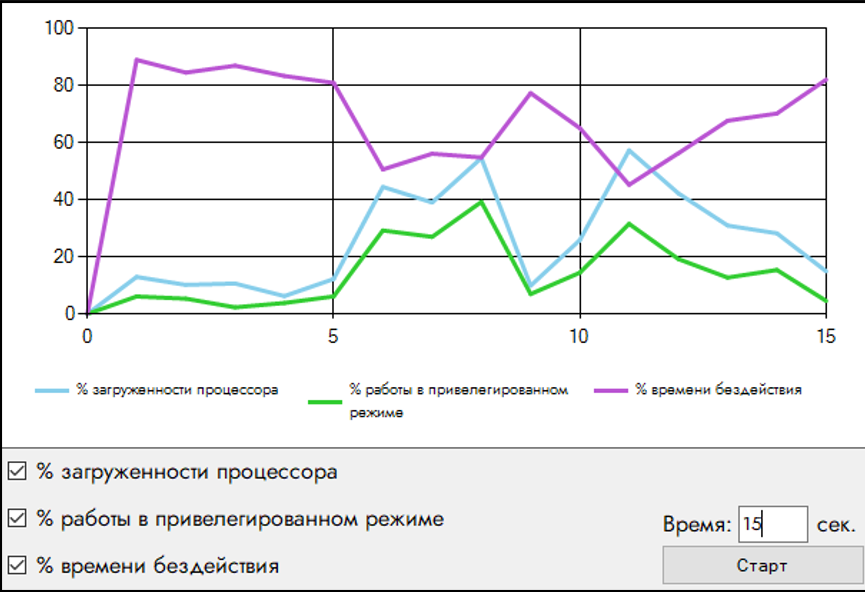
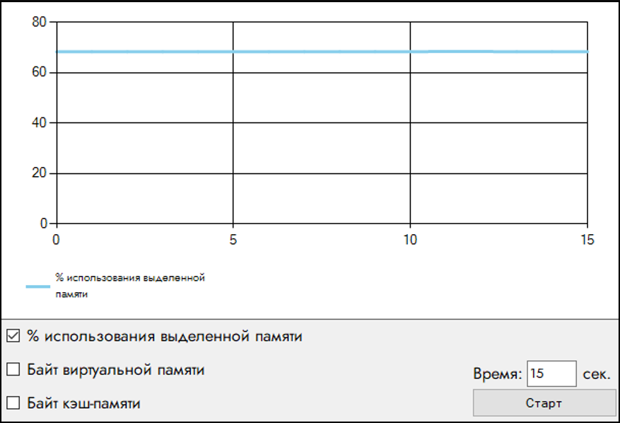
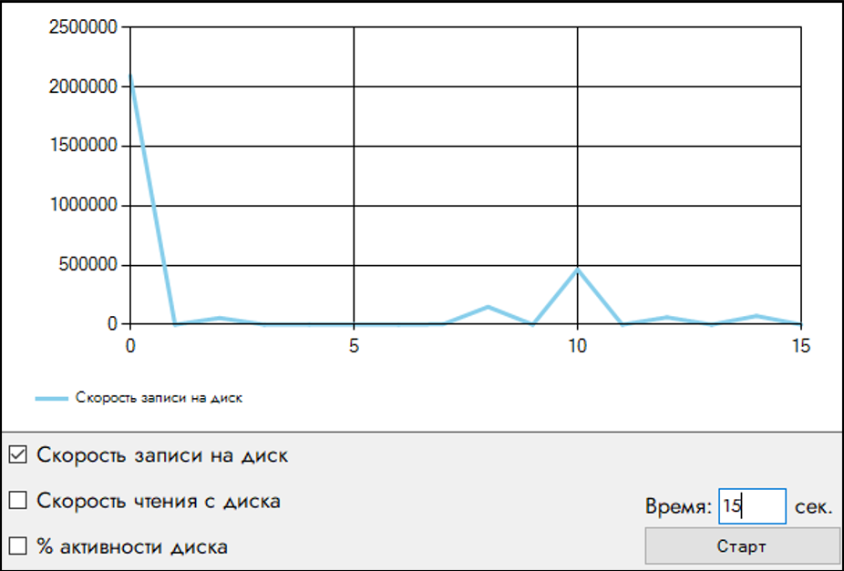

# Performance Counters Monitor (Монитор счетчиков производительности)

Приложение Windows Forms на платформе C# (.NET Framework 4.7.2), предназначенное для мониторинга и графической визуализации счетчиков производительности операционной системы Windows в режиме реального времени.

---

## Назначение и возможности

Приложение предоставляет удобный графический интерфейс для отслеживания основных показателей работы подсистем компьютера.

### Отслеживаемые показатели

#### Центральный процессор (CPU)
- `% загруженности процессора` (`Processor / % Processor Time / _Total`)
- `% времени бездействия` (`Processor / % Idle Time / _Total`)
- `% работы в привилегированном режиме` (`Processor / % Privileged Time / _Total`)

#### Оперативная память (RAM)
- `% использования выделенной памяти` (`Memory / % Committed Bytes In Use`)
- `Доступно виртуальной памяти` (`Memory / Available Bytes`)
- `Кэш-память` (`Memory / Cache Bytes`)

#### Физический диск (DISK)
- `Скорость записи на диск` (`PhysicalDisk / Disk Write Bytes/sec / _Total`)
- `Скорость чтения с диска` (`PhysicalDisk / Disk Read Bytes/sec / _Total`)
- `% активности диска` (`PhysicalDisk / % Disk Time / _Total`)

### Особенности реализации

Сбор метрик и опрос счетчиков вынесены в отдельный фоновый поток `System.Threading.Thread`, что предотвращает зависание графического интерфейса при длительных операциях. Доступ к элементам управления и графику синхронизируется с помощью конструкции `lock`, обеспечивая потокобезопасное обновление точек диаграммы. Пользователь может в реальном времени скрывать и отображать выбранные графики с помощью чекбоксов, а также задавать желаемую длительность мониторинга в секундах. Программа функционирует для всех категорий учетных записей Windows и не требует запуска с повышенными привилегиями администратора.

---

## Демонстрация работы

<div align="center">
  <table>
    <tr>
      <td align="center" valign="top">
        <br />
        <sub><b>Центральный процессор (CPU)</b></sub>
      </td>
      <td align="center" valign="top">
        <br />
        <sub><b>Оперативная память (RAM)</b></sub>
      </td>
      <td align="center" valign="top">
        <br />
        <sub><b>Физический диск (DISK)</b></sub>
      </td>
    </tr>
  </table>
</div>

---

## Стек технологий и требования

| Параметр | Значение |
| :--- | :--- |
| **Операционная система** | Windows 10 (или новее) |
| **Платформа** | .NET Framework 4.7.2 |
| **Язык разработки** | C# |
| **Основные библиотеки** | `System.Windows.Forms`, `System.Diagnostics.PerformanceCounter`, `System.Windows.Forms.DataVisualization.Charting.Chart`, `System.Threading` |

---

## Структура проекта

```text
performance-counters/
├── PerformanceCounters.sln              # Файл решения Visual Studio
├── PerformanceCounters/
│   ├── App.config                       # Конфигурация сборки .NET Framework
│   ├── PerformanceCounters.csproj       # Файл проекта C# WinForms
│   ├── Program.cs                       # Точка входа в программу
│   ├── MainForm.cs                      # Главная форма приложения (навигация и переключение вкладок)
│   ├── MainForm.Designer.cs
│   ├── MainForm.resx
│   ├── Performance Pages/               # Пользовательские элементы управления (UserControl)
│   │   ├── PerformanceCPU.cs            # Мониторинг процессора и построение графиков CPU
│   │   ├── PerformanceRAM.cs            # Мониторинг и графики оперативной памяти
│   │   └── PerformanceDISK.cs           # Мониторинг скорости и активности диска
│   └── Properties/
│       ├── AssemblyInfo.cs
│       ├── Resources.resx
│       └── Settings.settings
├── docs/
│   └── images/                          # Иллюстрации и скриншоты интерфейса
└── README.md
```
